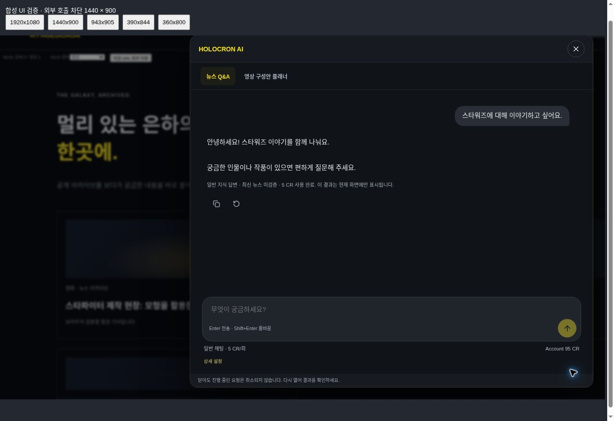
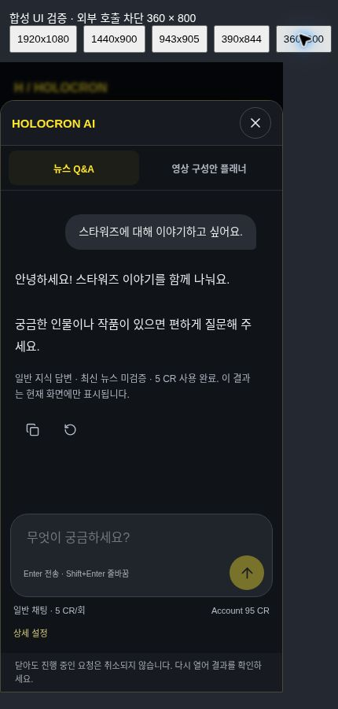

# Simple chat Acceptance PASS and chat UX refresh

## Production acceptance and shutdown (read-only audit)

The owner reported one real general-chat answer displayed naturally, a 5 CR charge, and balance 4 CR. This is the first successful simple-chat Production acceptance; it does not establish news Q&A or Planner acceptance. The earlier BLOCKED record remains historical and unchanged.

- Starting canonical: `6300ef4833c6d7e5364117d11648ef89a7f5413a`, tree `f870ab15938cbe40cf82f12fe9ac4d6bf775f8b8` (previous acceptance documentation only).
- Production runtime remains v97, source `8c9caa20f6da2fa031612aea65fa0d4c6bd89793`, tree `e2cbfb110d07dfee324e65981145521fb53d103d`.
- Sites commit: `cc68ffbaaf93c0edc89e888093f1b90faee0acfa`.
- AI OFF was applied first, environment revision **66** (from ON revision 65), by redeploying the same saved v97. Deployment `appgdep_6ae1b5ae3498819194f94fe085f0d66e` **succeeded** at `2026-10-28T08:43:41.793757Z`.
- `site_visibility_v1` remained `MAINTENANCE`, settings revision 3. No other environment value or site setting was written.
- Compared to the pre-test read-only snapshots: generation admissions **+1**, action `qa`, state `completed`; searches **+0**. The prior search is completed and unchanged.
- Matching ledger entry: one `ai_spend` debit, requested/applied **-5 CR**, resulting balance **4 CR**, at `2026-10-28T08:24:31.118Z`. No matching refund, no pending admission. Wallet also reads **4 CR**. All 486 available ledger rows were read via bounded native pagination to verify the matching debit without writing data.
- Monthly counters increased by **1 attempt / 1 known attempt**. Reservation and reconciled reservation each increased by 19,200 microUSD. Usage-based actual estimate increased by **273 microUSD ($0.000273)**; this is not an invoice amount. New admission records the same estimate.
- No additional live search, generation or Provider request was made by the agent. No credit adjustment, migration, restore, collection trigger, or PUBLIC transition.
- No request ID, account identity, prompt text, output text, cookies, receipts, or secrets are recorded here.

Verdict: **simple-chat answer display PASS (owner observation), 5 CR settlement PASS, AI OFF restoration PASS**.

## UI-only refresh

- A single overlay title, two compact existing tabs, right-aligned question bubble and plain assistant answer. Existing server-owned citations remain directly below archive answers. General chat has no invented sources.
- `chat-composer.tsx` owns the growing textarea and round send icon. Price remains visible near the composer: general chat 5 CR/request, archive search 1 + Q&A 5, Planner search 1 + generation 7. The accessible send name also includes the price.
- Enter submits; Shift+Enter adds a newline. Native composition flag, composition lifecycle and keycode 229 guard IME Enter. In-flight session guard remains the payment authority in the UI.
- Completed output clears the composer, while the submitted question remains in its message. There is no new transcript storage or multi-turn model memory. Only the existing current exchange is retained while the overlay remains mounted.
- `message-actions.tsx` owns small Copy and Regenerate actions. Copy awaits the clipboard operation and reports completion/failure briefly. Archive copies include server-owned references.
- Regenerate opens the existing priced confirmation flow; it does not submit. General-chat confirmation uses the original submitted question, an explicitly confirmed server policy version, and one new UUID. Unsent composer drafts are preserved during regeneration.
- Insufficient balance, pending/unknown settlement, in-flight work and invalid archive Receipt still block regeneration. Close revokes an unused confirmation. Cancel, reopen and tab changes do not send a new request.
- Consolidated the existing workspace CSS instead of appending another override layer. The composer stays outside the scrolling message area; expanded settings are inside it.

No backend route, Provider/Profile, model, validator, pricing, admission, Ledger, Migration 0020, Backup v10, SWNN, collection, image, Scheduler, or Racing source changed. The only production operation was the separately authorized OFF redeploy of unchanged v97. This new UI is **not deployed**.

## Verification

| Check | Result |
| --- | --- |
| TypeScript `tsc --noEmit` | PASS |
| ESLint | PASS, 0 errors; existing unused `debit` warning in refund-safety test remains |
| Framework build | PASS |
| `git diff --check` | PASS |
| Assistant workspace | 185 assertions PASS: prices, text escaping, clipboard contract, Enter/IME/Shift+Enter, submit lock, original-question regeneration, cancel/reopen, UUID, unknown settlement, Receipt and policy drift |
| Assistant UI | 35 assertions PASS: SSR, OFF gate, citation security, source scope and settlement |
| Account Assistant | PASS: actual UI/hook -> HTTP -> isolated D1 -> Mock Provider, chat 5 CR and explicitly confirmed additional 5 CR; archive 1+5 / Planner 1+7, replay, concurrency and refunds |
| Refund safety | 586 assertions PASS |
| Admission | 265 assertions PASS |
| Provider | 84 assertions PASS, Node/workerd; no live calls |
| Backup | 939 assertions PASS; contract source unchanged |

### Chromium, actual components with intercepted HTTP

`browser-qa/assistant-overlay-fixture.tsx` bundles the real overlay/workspace components. All HTTP in the fixture is intercepted; unexpected outbound routes throw. No Production sessions or DB are used.

- 1440 x 900 and 360 x 800 CSS viewports: one title, tabs, answer, small actions, clear pricing and accessible send control.
- Mock direct-chat success: search count 0, generation count 1, 5 CR decrement, textarea emptied and question retained.
- Copy completed through the isolated HTTP-preview clipboard sink. Real HTTPS OS clipboard permission remains a post-deploy user check.
- Regenerate open/cancel: no new request. Explicit confirmation double-click: exactly one new generation. Close/reopen: no new request; Esc returns focus to launcher.
- Shift+Enter preserved newline; Enter sent once. Busy controls were disabled. IME composition guards are synthetic event tests, not a claim of physical Korean keyboard/device coverage.
- Long 12-paragraph response on 360px: document width 360px, dialog width 358px, message area 402px high with 1613px content; composer height and scroll height both 185px, proving it is not the scrolling result pane. No horizontal overflow; input empty after completion.
- Pending refund: failure notice and unknown-settlement explanation; regeneration and submit disabled.
- Archive Q&A: real fixture evidence links displayed, 1+5 CR. Planner: existing sections and links displayed, 1+7 CR. Backend functionality not expanded.
- Physical mobile soft keyboard and assistive screen-reader behavior are not claimed as tested. Native dialog/focus semantics and touch sizes are retained; reduced-motion stylesheet remains.

## Handoff

Canonical publication only. Production remains **v97 / environment 66 / AI OFF / MAINTENANCE**. Deploying this UI or reactivating AI requires a separate owner instruction. This work adds no live Provider calls or credit spend beyond the owner's already-completed single acceptance request. Do not infer new Production UX acceptance from the local Mock screenshots.
