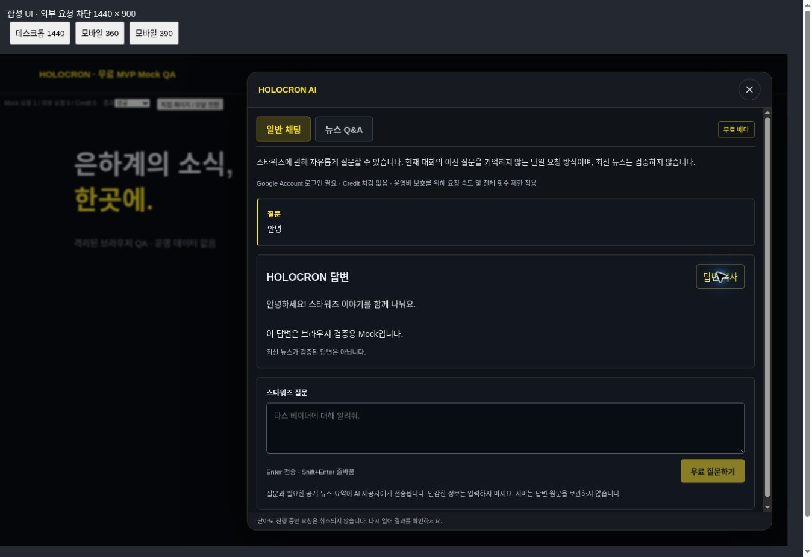
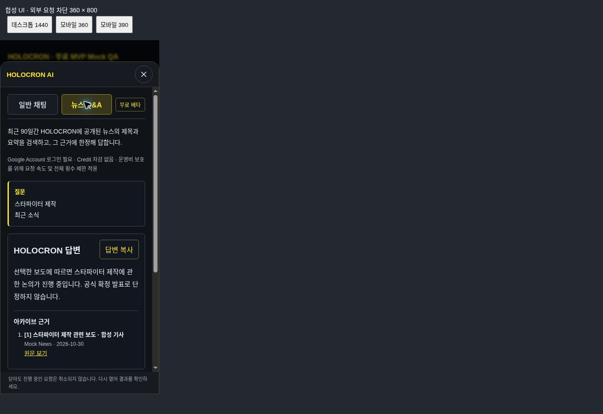

# 무료 AI MVP / 0020 출시 준비 검증 — 2026-10-30 KST

## 판정

**로컬 무료 MVP 검증 PASS. Production 배포는 NO-GO.**

실제 GPT 호출은 하지 않았다. Production Site/API/DB/환경값에 접근하거나 변경하지 않았다. 마지막 사용자 보고의 v97 / 환경 66 / AI OFF / MAINTENANCE는 이번 실측값이 아니다. main 병합·변경 없음.

## Source

- fresh fetch main: `93646c066aaf8a33f1a7c062f8404dd7cd7b211e`
- main tree: `9ae882149edb6d46f1c95b845e453e3323f6cf99`
- 작업 브랜치: `feature/assistant-free-mvp-0020`
- 시작 SHA: `780af96f33cb89003a648543cbbdcd550fdcb985`
- 시작 tree: `b44f65b547af32f33b500fb5f671aa4824103d80`
- 분기 기준 v97 앱 SHA: `8c9caa20f6da2fa031612aea65fa0d4c6bd89793`
- 이 보고서를 포함한 커밋이 수정 결과다. 최종 SHA/tree와 해당 SHA의 GitHub Actions 결과는 작업 최종 응답에서 기록한다.
- 별도 worktree에서 작업. 기존 체크아웃 및 미배포 main의 0021/0022를 가져오지 않았다.

## 확인한 결함과 최소 수정

1. **UUID 재실행 위험:** 기존 3일 정리 로직은 오래된 무료 요청을 삭제해 동일 UUID로 Provider를 다시 호출할 수 있었다. 내용 없는 UUID/HMAC 기록을 보존하고 무료 기록 10,000건에서 신규 Admission을 원자적으로 차단한다. 무료/유료 기존 기록을 삭제하지 않는다. 용량 한도 도달 시 중단하는 베타 계약이며 영구 무제한 운영 계약이 아니다. 매일 40건이면 약 250일이다. 임의 삭제로 재개하면 Replay 보호가 사라진다.
2. **요청 수명:** 뉴스 Q&A가 새 AbortController를 사용해 HTTP 취소를 전달하지 않았다. 기존 35초 서비스 시간에 맞춘 AbortSignal과 요청 취소를 양쪽 모드에 연결하고, 늦어진 DB/검색 후에는 Provider를 시작하지 않는다. Provider 자체 30초 제한은 유지한다. DB 호출 자체를 강제 취소할 수 있다는 뜻은 아니다.
3. **불확정 종료의 동시성:** 실패/취소 시 기존 60초 lease를 즉시 없애지 않는다. 실패 기록도 유효 lease 동안 동시성 한도를 소비한다. 원격 Provider가 취소 즉시 연산을 중단한다고 보장하지 않는다.
4. **진단 연결:** 무료 Route에서 기존 content-free WARN Logger를 연결했다. Provider/OutputValidationError의 허용 stage/reason/path만 관측한다. 원문·질문·계정·UUID·Secret을 추가하지 않는다. 로깅 실패는 응답 상태 처리에 영향을 주지 않는다.
5. **모달 스크롤:** 기존 CSS는 두 번째 자식 div만 대상으로 하여 새 section workspace가 맞지 않았다. 무료 section에 높이·내부 스크롤을 적용했다.
6. **UI 종료:** 클라이언트 응답 대기를 45초로 제한하고 자동 재시도 없이 오류를 표시한다. IME의 keyCode 229 방어를 유지/추가했다. Clipboard 완료/실패 안내를 제공한다.

Prompt, 모델/Profile, 검색 정렬, Output Validator, Planner 구현, Credit 정책, Collector, Racing, DB Schema는 변경하지 않았다. 일반 채팅/뉴스 Q&A는 무료이며 기존 retrieve/generate Route는 모든 설정에서 503으로 차단한다.

## 실행 결과

환경: Node v24.22.1, 기존 동일 lockfile의 pnpm 의존성 재사용, 로컬 Miniflare/workerd, 실제 빌드 Worker. 새 의존성 없음. 모든 Provider transport는 Mock이며 그 외 outbound는 차단했다.

| 명령/검증 | 최종 결과 | 범위 |
|---|---|---|
| `pnpm test:assistant-free-mvp` | PASS | 0020 D1 + 실제 handler, 최종 실행 Mock transport 9회; 실호출 0 |
| `pnpm test:assistant-free-built` | PASS | 실제 패키징 Worker HTTP→Account→D1→Mock→응답, Mock 3회 |
| `pnpm test:assistant-provider` | PASS | 84 assertions, Node/workerd 토큰·Envelope·timeout·단일 fetch |
| `pnpm test:credit-foundation` | PASS | 103 assertions, 원장/원자성/rollback |
| `pnpm test:assistant-admission` | PASS | 265 assertions, 기존 유료 도메인 보호 |
| `pnpm test:assistant-output-hardening` | PASS | 24 grounding 시나리오 및 진단 보호 |
| `pnpm test:assistant-retrieval` | PASS | 637 assertions, 검색·snapshot·Receipt; 비활성 유료 Route 계약 갱신 |
| `pnpm test:backup` | PASS | 939 assertions, 스크립트가 보고하는 v1–v8 테스트 범위; 신규 v10 원본 감사는 아님 |
| `pnpm lint` | PASS | 오류 0; 기존 refund-safety 테스트의 unused `debit` 경고 1 |
| `pnpm exec tsc --noEmit` | PASS | 타입 검사 |
| `pnpm build` | PASS | Vinext/Vite Worker 및 client 산출물 |
| `git diff --check` | PASS | 공백 오류 없음 |
| 실제 유료 GPT / Production Acceptance | NOT RUN | 이번 승인 범위 밖 |

초기 실패를 숨기지 않는다. Retrieval 테스트는 비활성 Route에 401/405를 기대하고 새 Admission 모듈에도 `.run()` 금지를 일괄 적용했다. 의도된 503 및 무료 Admission의 별도 무변경 감사에 맞춰 좁게 수정했다. Output hardening 테스트는 Logger 연결 검사 대상을 닫힌 generate에서 free Route로 변경했다. 기존 보안/grounding 단언은 유지했다. 새 테스트 작성 중 AbortSignal 주입 위치와 workerd 로그 callback의 void 반환 오류도 수정 후 재실행했다. 전체 저장소의 모든 테스트를 실행했다고 주장하지 않는다.

### 무료 요청의 격리 검증 내용

- 잔액 0 Account의 채팅/뉴스 Q&A 성공, 로그인 없음·위조 Cookie·다른 Origin·same-site sibling·잘못된 입력 차단.
- 모델 응답의 안전한 텍스트, 허위 형식 거부, 서버 소유 기사 링크, 근거 없음 시 Provider 0회, 응답 도중 기사 비공개 변경 시 거부.
- 기존 유료 Route 503, AI OFF와 무료 MVP OFF 각각 Provider/DB 접근 전 차단.
- 동일 UUID 병렬 처리 중 Provider 1회, 다른 질문/계정 UUID 충돌 차단, 결과 미수신·취소 후 동일 UUID 재실행 차단.
- D1 INSERT 또는 완료 UPDATE가 반영된 뒤 응답만 유실되는 모의 오류: 재시도 시 추가 Provider 없음.
- 계정 분당 3회·시간당 8회, 전체 동시 3개, KST 하루 40회. 마지막 일일 슬롯을 여러 계정이 동시에 요청해도 1개만 허용. KST 자정 경계 확인. 실패와 근거 없음도 이미 Admission되면 횟수에 포함된다.
- 3일 이후에도 UUID 재실행 차단, 기존 검색 행 보존, 10,000건 용량 차단.
- 합성 과거 잔액/원장 포함 `credit_wallets`, `credit_ledger`, `credit_policy_revisions`, `assistant_admissions`, `assistant_monthly_costs`의 모든 행을 요청 전후 비교해 동일함을 확인했다. 테스트 fixture 생성으로 인한 변화와 무료 요청 변화를 분리했다.
- 실제 Worker의 WARN sink에서 schema / SCHEMA_TYPE / $.answer 확인. 클라우드 로그 전달 검증을 재수행한 것은 아니다.

## 브라우저 결과

지원 cloud Chrome에서 실제 FreeAssistantWorkspace와 AssistantOverlay를 렌더링했다. 1440×900 / 360×800 CSS iframe viewport를 사용했고 외곽 브라우저 캡처에는 QA 프레임이 포함된다. UI fetch Mock과 CSP `connect-src 'none'`로 운영/Provider 연결을 차단했다.

- PASS: 무료 두 탭·플래너 비노출, 일반 답변, Q&A 출처 링크, 로딩/오류 종료, 입력 초기화, Enter/Shift+Enter, 중복 클릭 시 Mock 요청 1건.
- PASS: 닫기/Esc와 launcher 포커스 복귀, 재열기 시 상태 보존 및 재요청 없음, 긴 20문단 답변, 모바일 입력 접근과 내부 스크롤, 360px 가로 넘침 없음.
- PASS: 실제 Clipboard 내용을 읽어 Mock 답변 복사를 확인했다. 최초 비동기 복사 직후의 빈 clipboard는 실패 증거가 아니었다.
- PASS: 합성 isComposing=true/keyCode229 Enter 이벤트에서 요청 0건.
- NOT VERIFIED: 실제 한국어 OS IME·모바일 OS 키보드, 실제 Google 로그인 브라우저, Production SSR 전체 페이지. 직접 페이지 검증은 동일 workspace 컴포넌트의 fixture 렌더링이며 `/assistant` Production 접근이 아니다. HTTP→D1→Mock 검증은 별도 실제 패키징 Worker 테스트에서 수행했다.
- 새로고침은 서버 결과를 복구하지 않으며 자동 재요청하지 않는다. 모달 닫기는 진행 요청을 취소하지 않고 재열기 시 완료 결과를 확인한다. 다중 턴 기억 없음.

## DB 0020·Backup·장기 충돌

- v97 앱 기준과 `drizzle/`, `db/`의 Git diff가 비어 있다. SQL, journal, snapshot 모두 보존했고 신규 Migration은 0개다.
- 격리 D1은 0000–0020 SQL만 적용했다. 새 테이블/컬럼 없이 실제 Worker 경로가 동작했다.
- 빌드 `dist/.openai/drizzle`은 source `drizzle`과 재귀 비교에서 동일하다. 최종 SQL은 0020이며 0021/0022는 없다.
- `run_worker_first:true`를 실제 build config에서 확인했다. Wrangler의 `migrations:[]`는 D1 미적용 증거가 아니다.
- Backup v10 코드·계약은 변경하지 않았다. 기존 assistant_searches 제외 규칙에 따라 무료 UUID/HMAC 기록도 백업에서 제외된다. 따라서 **복원 시 Replay/횟수 보호 기록이 유실된다**. AI OFF 상태의 별도 운영 절차 없이 복원/초기화하면 안 된다.
- 기존 account-search의 범용 정리 코드는 marker를 지우거나 오래된 행을 삭제할 수 있다. 이번 후보의 유료 API는 항상 닫혀 있고 해당 정리 경로를 호출하지 않는다. 향후 유료 Route 재개 또는 옛 Runtime을 AI ON으로 롤백하면 충돌 위험이 있다. 무료/유료를 동시에 켜지 않는다.
- 10,000건 보존은 용량을 제한하면서 UUID를 보호하는 절충이다. 용량 도달 시 운영 검토가 필요하고, 무한 보관/삭제를 자동 해결했다고 주장하지 않는다. FK Account 식별자와 HMAC은 내용 원문은 아니지만 보안 관리 대상이다.

## 비용 보호와 실제 GPT 테스트 준비

모델/Profile은 `gpt-5.4-mini-2026-03-17` / `gpt-5.4-mini-2026-03-17-o200k-v1` 그대로다. 공식 모델 문서는 이 snapshot, Responses 및 Structured Outputs를 제공하고 text input $0.75 / output $4.50 per million tokens를 명시한다. 해당 운영자 프로젝트/key의 실제 사용 권한은 이번에 조회하지 않았다.

공식 근거: https://developers.openai.com/api/docs/models/gpt-5.4-mini (2026-10-30 확인).

- 요청당 입력 예산 16,000 / 출력 1,600 token. 현 profile 단가 계산 최대 **$0.0192/회**.
- 40회/KST일이면 산술상 최대 **$0.768/일**, 31일 **$23.808**. 이는 profile·토큰 추정·현 단가를 전제로 한 계산이다. 실청구 보증이나 공유 운영비 한도가 아니다.
- 예시 1,000 input / 200 output이면 **$0.00165/회**. 실제 예상 사용량을 측정한 값은 아니다.
- **달러 기준 일/월 예약·정산·누적 하드 캡은 무료 경로에 없다.** usage는 Provider 응답 검증에 쓰이지만 비용 이력에 영속 저장되지 않는다. 기존 월 비용 표에는 무료 요청 비용이 포함되지 않는다. 관리자 예산 표를 무료 경로의 실청구 집계로 사용하면 안 된다.
- 요청 제한은 원자적 D1 기준이며 실패도 소비한다. Provider 자동 retry 0, server-only key, 단일 fetch, 토큰 제한, 양쪽 OFF 플래그 유지. 계정 다수로 전체 한도를 독점하는 가용성 공격은 여전히 가능하다. HTTP 취소는 원격 비용 0을 증명하지 않는다.
- 출시 전 운영자가 이 비용 보호 수준을 명시적으로 수용하고 별도 Provider 프로젝트의 실제 사용량을 관측할 수 있어야 한다. 정확한 달러 하드 캡이 필수라면 별도 설계/승인까지 BLOCKED다.

추후 별도 승인 가능한 격리 시험: 합성 Account/독립 로컬 D1, 운영 DB 미연결, 서버 전용 별도 제한된 프로젝트 key를 ignored 환경에 안전하게 주입. 값은 출력·커밋하지 않는다. 채팅 ‘안녕’ 1회와 합성 공개 기사 기반 Q&A 1회, 각 단일 UUID·자동 재시도 금지, 합산 profile 최대 $0.0384. 자연스러운 한국어/서버 출처/무차감/요청 1회/정상 종료가 성공 기준이다. 오류·불확정이면 추가 호출 없이 종료한다. 이번에는 key 조회·생성·주입 또는 실제 API 호출을 하지 않았다.

## Sites 게시 조사와 NO-GO 근거

읽은 공식 plugin 문서: `sites/SKILL.md`, `sites/references/storage.md`의 Schema Changes. 문서는 **Sites가 Worker 업로드 전에 hosted migrations를 적용한다**, **실패한 배포라도 Migration은 이미 적용되었을 수 있다**, **불명확한 Migration 상태를 먼저 해결한다**고 명시한다. 지원 도구 계약은 저장된 정확한 source version을 배포하도록 하지만 D1 pending migration dry-run/no-migrate 옵션은 제공하지 않는다.

로컬의 `build/sites-vite-plugin.ts`는 `drizzle` 전체를 `dist/.openai/drizzle`로 복사한다. source와 artifact가 0020까지만 포함한다는 사실은 확인했다. 그러나 서버의 실제 migration 선택·현재 journal 대조 결과·기존 저장 버전의 migration 취급은 로컬 코드만으로 증명할 수 없다. 현재 운영 Journal·Trigger는 새로 확인하지 않았다.

| 질문 | 답변 |
|---|---|
| 0020 DB에서 무료 코드 동작 가능? | **로컬 PASS**. 실제 0020 schema와 패키징 Worker 검증. 운영 DB 실상은 별도 확인 필요. |
| 신규 Migration 실행 0 보장? | **NOT VERIFIED**. 브랜치/산출물에는 0021/0022가 없지만 hosted pending 계획을 확인할 수 없음. |
| 게시 없이 가능한 것? | SHA/tree, SQL/journal 바이트 비교, 산출물 manifest, 로컬 Worker/D1/Mock/브라우저, 공식 계약 조사. |
| 실제 게시 후에만 확인되는 것? | Worker version/env 적용, 운영 D1 binding과 실행, 실호스팅 접근·캐시. 게시를 진단 수단으로 시험하지 않음. |
| 현재 출시 가능? | **NO-GO**. 신규 migration 0 및 실제 운영 schema/배포 경로 증거가 부족함. |

최소 플랫폼 문의 문안(실제로 보내지 않음):

> 기존 Site의 D1은 0020으로 보고되어 있습니다. 후보 source/artifact의 drizzle SQL/journal/snapshot은 v97과 바이트 단위 동일하며 0021/0022가 없습니다. Sites가 pending D1 migration을 선택하는 정확한 입력 경로와 journal 기준은 무엇입니까? 기존 저장 버전 또는 다른 source branch의 migration이 합쳐질 수 있습니까? 게시 전에 이 후보의 적용 예정 migration이 0개임을 확인하는 지원되는 read-only 계획/서버 확인을 제공할 수 있습니까? 기존 DB에 DDL을 실행하지 않는 Runtime-only 배포가 지원된다면 그 공식 절차를 알려주십시오. 운영 변경은 아직 승인하지 않았습니다.

## 배포 전 STOP·OFF·Rollback

1. source/tree 및 0016–0020 immutable 비교, artifact의 migration set을 고정한다. main을 merge하거나 0021/0022를 재구성하지 않는다.
2. 플랫폼이 해당 후보의 신규 DDL 0 및 운영 schema 호환을 확인할 때까지 배포하지 않는다. 미확인 journal을 수정하거나 테이블 존재로 대신 증명하지 않는다.
3. 별도 승인된 최신 backup 보존·무결성 확인과 운영 설정 스냅샷이 필요하다. 이번 작업에서 export/restore는 하지 않았다.
4. 별도 승인 후에도 두 AI flag false, MAINTENANCE 상태로 Runtime 설치부터 검증한다. live 테스트와 공개 전환은 각각 별도 승인이다.
5. 긴급 중단은 지원되는 환경 변경·적용 경로로 AI flag false를 적용하고 실제 Worker의 OFF를 확인한다. 이미 전송된 Provider 비용은 취소만으로 소멸하지 않는다.
6. 코드 rollback은 승인된 저장 version/source와 **AI OFF**로만 계획한다. D1 downgrade/restore/과거 migration 재실행을 rollback 수단으로 사용하지 않는다. 구 Runtime의 paid-search cleanup을 AI ON으로 실행하지 않는다.
7. 비용 보호 수용·별도 프로젝트 관측, 격리 실제 GPT 검증, 지원되는 배포 경로 증거가 남아 있다. 로컬 Mock PASS를 Production GPT 성공으로 바꾸어 보고하지 않는다.

Production 배포/설정/DB 쓰기 0건. 실제 Credit 차감·환불·조정 0건. 실제 OpenAI Provider 호출 0회. 별도 승인 없이 다음 단계로 진행하지 않는다.
