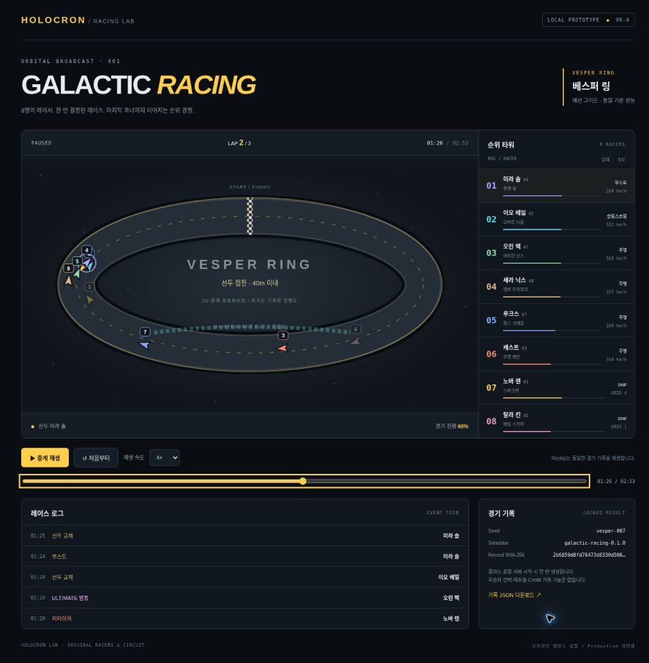

# Phase 9R-A — Galactic Racing local prototype

Status: **IMPLEMENTED / OFFLINE VERIFIED / NOT DEPLOYED** (2026-10-22).

The authoritative TypeScript simulator and its local 2D broadcast are executable. This is one original circuit and eight original racers, with no account, Credit, prediction market, scheduler, Production route or database connection.

## Run on your computer

From a clean canonical checkout, use Node >=22.13 and the repository's pinned pnpm version. Install existing dependencies with the official command if needed:

```bash
pnpm install:ci
pnpm test:racing
pnpm racing:prototype
```

Open `http://127.0.0.1:4173/` in your browser. No API key or login is needed. Stop with Ctrl+C. The command builds the small standalone viewer into ignored `out/galactic-racing/` and computes one race before listening. It does not run the HOLOCRON application or its scheduled jobs.

The default demonstration seed is `vesper-007`: a deliberately illustrative replay with two Ultimates, a lower-grid winner and two retirements. It is **not** a representative balance sample. To study another offline race, stop the server and start a separate experiment:

```bash
pnpm racing:prototype --seed your-experiment-001 --port 4173
```

Seeds must be 1–64 ASCII letters/digits/underscore/hyphen. There is no in-viewer winner selection or reroll button. Local experiments are not scheduled production races. Do not select a favorable seed for a future market: production seed commitment, secrecy, generation authorization and durable create-once storage remain separate work.

Controls: Play/Pause, 0.5×/1×/2×/4×, timeline scrub, Replay from the start. The timeline slider supports keyboard arrows/Home/End. The result is generated once on the local server, not by a browser animation frame or by Replay. The viewer shows positions, ranks, km/h, laps/progress, event feed, Ultimate/accident/pit/penalty/retirement states, lead battle, finish crossings and final classification.

The JSON download contains the full record. `X-Race-SHA256` is the server-generated byte digest shown in the viewer; `sha256sum race.json` can verify downloaded bytes. It is a consistency digest, **not an authentication signature**. No browser-provided results are accepted. The local handler only serves a fixed allowlist of in-memory resources over GET/HEAD; POST and regeneration paths are rejected. The default host is loopback. `--host 0.0.0.0` exists for an isolated managed QA gateway, not normal public hosting.



## Responsibilities

| Module | Responsibility |
| --- | --- |
| `lib/racing/types.ts` | Read-only record, event, frame and config contracts |
| `lib/racing/config.ts` | Versioned common performance, track, probabilities and caps |
| `lib/racing/prng.ts` | Seed/domain hashing, integer PRNG and qualifying permutation |
| `lib/racing/events.ts` | State transitions, damage, stops, retirement and Ultimate |
| `lib/racing/simulator.ts` | Authoritative bounded integration, classification and deep-frozen record |
| `lib/racing/playback.ts` | Pure record lookup/interpolation, without an engine/PRNG import |
| `scripts/racing/` | Local server, read-only response handler and Monte Carlo tooling |
| `prototypes/galactic-racing/` | Standalone React/SVG/CSS viewer; outside `app/` |

## Simulation contract

- Version **`galactic-racing-0.1.0`** freezes the algorithm, roster and constants. Seed + supported version reproduces qualifying, results, events and every recorded frame. Unknown versions fail closed. Published tuning must bump the version and explicitly update its golden fixture; historical JSON records continue to replay without recalculation.
- FNV-1a domain seed → Mulberry32 integer PRNG. Qualifying and each racer's draws have separate streams. No `Math.random`, wall clock, market price, crowd popularity or administrator-picked winner enters the simulation. This PRNG is for reproducibility, **not cryptographic unpredictability**.
- Qualifying is a deterministic shuffled order in this first prototype; qualifying lap-time simulation is not implemented. It creates only a **16 m gap per grid place** (P8 is 112 m behind P1), never a racer-specific speed modifier. All eight share the same performance and event rules.
- Three laps, 7.2 km total; 250 ms integration ticks, event decisions every 2 seconds. Distances use integer centimetres; speed uses cm/s; finish times are millisecond interpolation within the final tick. Ties use qualifying grid order.
- Slipstream uses a shared pre-step proximity snapshot, avoiding iteration-order proximity errors. Boost/shortcut events have mild trailing-rank weighting. The SVG lanes are visual separation only, not different track lengths. Shortcut success advances progress; the decorative shortcut is not a simulated physical trajectory.
- Minor causes brief slowdown/damage; Medium causes a longer slowdown/stop and sometimes a repair pit; Major causes a larger stop/penalty/pit or DNF/DSQ. Pit completion repairs damage. DNF/DSQ are terminal; they do not resume or finish later. Finishers classify first by finish time, then DNF by progress, then DSQ; exact ties use grid.
- **DNF + DSQ combined cap = 2 per race**. Once consumed, a later severe retirement roll becomes a time penalty/pit. Cap priority rotates across racers on decisions instead of always preferring one racer ID.
- Ultimate is eligible only between 20% and 90% progress, at most once per racer. Per eligible decision chance increases from 0.1% at rank 1 to 0.6% at rank 8. It gives randomized 3–6 seconds and 1.25–1.55× power. Ordinary bad-event resistance is 65%, Major 25%; a failed shortcut remains dangerous. It never forces a win.
- Worst-case bounds: **2,400 ticks / 600 simulated seconds / 19,208 racer-frame entries / 12,000 timeline events / 8 racers**. An exhausted bound throws and returns no race, rather than silently truncating or inventing extra DNF. Monte Carlo accepts only 10,000–100,000 races; summary mode omits replay frames but uses the identical RNG/result/event path.
- Deep read-only types and runtime freezing protect generated records. This phase provides process-local immutability and reproducibility, not a database uniqueness/commitment protocol. Future production persistence must enforce write-once identity and store the version/config/record digest.

## Reproduce balance measurement

```bash
pnpm racing:balance 40000 work/racing-balance-check.json
```

Output files are exclusive-create, so choose a new path if one exists. Compare `resultEventDigest` with [9r-a-balance.json](9r-a-balance.json). The statistic uses `mc-v1-0` through `mc-v1-39999`, not the demo seed. See [balance interpretation](9R_A_BALANCE.md).

## Verification and limits

- Golden entire-record digest; repeat/different/invalid seed and unsupported version; deep immutability; 512 full/summary pairs; every event kind; finish order; monotone progress; no resurrected retirement; event/tick caps; one Ultimate per racer; controlled rank probability/resistance; replay purity; read-only HTTP handler and byte digest tests.
- 40,000 completed offline races, no cap violations or bound failures. Event count and runtime are bounded by the engine; this is not a Production performance/load certificate.
- Actual Chromium: grid, 8 racers, moving ranks/progress, Play/Pause, 4×, keyboard timeline, finish/final standings and identical Replay verified. Browser download-event automation timed out; the response handler's bytes/hash/attachment contract is tested directly. Narrow/mobile physical devices and touch interaction have **not** been acceptance-tested; responsive CSS is present.
- Main application TypeScript/Lint/Build and relevant existing service regressions pass. No new application route, package dependency or lockfile change.
- No Credit, prediction market/odds, durable race storage, seven-race season, scheduler, accounts, 3D physics or public release. No claim that this sample proves player enjoyment, economic fairness or production-grade randomness. Test the replay's pacing before tuning the next version.
- Production v88 and Assistant OFF are untouched. Provider calls: **0**. Existing Assistant/evaluation files remain unchanged; broad `lib/` hash manifests may intentionally reject this new source tree. No historical manifest was rehashed.
