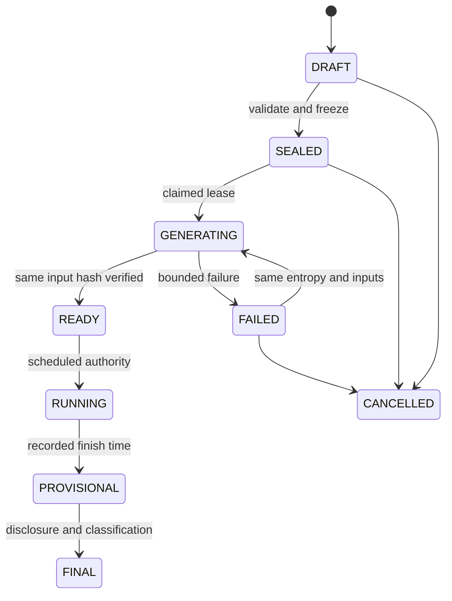

# Galactic Racing Phase 3 — implementation architecture (DESIGN ONLY)

Decision date: 2026-11-05. Basis: canonical main `93646c066aaf8a33f1a7c062f8404dd7cd7b211e`, Racing source `0f73784bcd23e9d9b80a7e0bae8c75696094fd8e`, v0.10 isolated acceptance branch. This document creates no runtime, migration, market, season or deployment authorization. Local complete replay JSON is **not suitable for premiere distribution**.

## 1. Existing boundaries and deployment baseline

Reuse the deterministic engines in `lib/racing/v*/`, immutable records, 250ms ticks, presentation-only camera/FX, fixed 30FPS player and existing server Account identity. Proposed runtime layers: `app/api/racing/*` thin HTTP routes → `lib/racing/service/*` commands → domain state machines → repository/D1. `lib/credit/repository.ts` owns Wallet/Ledger mutation. Never calculate outcomes from stakes, odds, profile fields, admin preference or viewer camera state.

The branch includes migrations through0022 and `lib/backup/format.ts` v12/0022/16 datasets. **This is source evidence, not installed Production evidence.** Last user report was v97/Environment66/AI OFF/MAINTENANCE/0020/v10. It has not been refreshed in this task. Prior migration journal/trigger-access and original-backup limitations remain release blockers. Do not infer installed migrations from table existence or exporter constants, and do not deploy this whole Racing branch onto0020.

Before implementation chooses a migration number: reconcile canonical runtime, the separate free-AI0020 branch, actual migration journal/checksums, trigger/index/FK/CHECK definitions, approved original backup and pending financial obligations. Racing must be integrated onto an explicitly approved baseline by a reviewed source diff, not by merging unrelated AI changes from this prototype.

## 2. Authority and immutable versions

| Object | Identifier / immutable content | Allowed edits |
|---|---|---|
| Racer | stable UUID, roster number; separate profile revisions | Profile text/image validation; no performance attributes |
| Track | content hash + version, road/branch samples and length | New version only; never overwrite used geometry |
| Simulator | exact code SHA, config hash, runtime/package manifest | New version; retain old executors and Goldens |
| Season | UUID, kind, timezone, roster snapshot, scoring revision | Draft only; exactly8 distinct racer IDs before lock |
| Race | UUID, season/R number, UTC schedule, roster/track/engine/config hashes | Draft schedule/config only; frozen before a market opens |
| Generation | one committed entropy identity per qualifying/race, input hash, output hash | Retry the same inputs; no new seed for an existing race |
| Official result | immutable versioned classification and points, DSQ evidence hash | One valid finalization; correction is a separate audited dispute protocol |
| Broadcast | published timeline revision + release timestamps | Bounded qualifying holds; never move close/start deadlines |

Regular season: Monday–Sunday KST, seven races R1–R7, one at21:00 daily, fixed eight entrants. Idempotent next-season key `regular:<monday-KST>`. Generate next season ahead of time; publish on Monday only after validation. A unique regular-slot key prevents collision; custom races cannot occupy an active regular broadcast window. Custom season supports arbitrary dates, e.g.3-day mini-season, explicit number/times/track/roster, champion-market opt-in and deadline. A roster replacement after lock applies to a future season; current race snapshots remain immutable.

Season score is the sum of **official** per-race points. Current engine points are25/18/15/12/10/8/6/4 (`lib/racing/v2/config.ts`); snapshot this revision rather than inventing a new scoring table. DSQ=0. Tie proposal: wins → P2 counts → P3 counts → best final-race finish among tied entrants → stable roster ID only as a published final deterministic tie-break. Exact tie/scoring revision is approved before season lock. Championship only final after every included race is FINAL or explicitly CANCELLED with a documented scoring policy. No invented result for unrun races. Regular champion prediction closes Wednesday20:55 KST; custom cutoff must be explicit and before its earliest eligible outcome publication.

## 3. State machines and commands

Race generation and broadcast are separate axes. A replay end or local camera action cannot write either.



READY/RUNNING cancellation needs elevated incident authority, reason and immutable audit; never cancellation merely to select another winner. After FINAL there is no ordinary rerun/cancel command. A technical incident freezes settlement and opens a reviewed dispute; it cannot rewrite already posted Ledger rows.

Commands require server admin session, Origin/CSRF, role, UUID idempotency key and expected state revision. `create-season`, `schedule-race`, `seal`, `generate`, `retry-generation`, `advance-qualifying`, `cancel`, `finalize` have separate capabilities. Generation operator cannot edit entropy/participants. A viewer is never an operator. A regular `manual-start` only requests processing of an overdue scheduled state; it cannot advance/delay21:00. Custom manual start is allowed only with markets already closed and no previously published start identity; publish one immutable timestamp.

CAS lease: `(race_id, job_kind, input_hash)` unique, `owner_token`, `lease_until`, `attempt`. Renew only own lease. An expired lease allows recomputation with identical seed/version; writing results requires matching input/output hashes and current owner. A conflicting hash is QUARANTINED, never last-writer-wins. Failure after object upload but before commit produces an unreferenced private object, eligible for delayed orphan GC. Publication pointer is committed only after content hash verification. Worker timeout is not permission to choose another seed.

## 4. Entropy and early-result security

Separate qualifying and main-race entropy. The current local `simulateMeeting` computes both at once; do not expose/reuse that interface as the live generation service. Phase3-A must extract versioned stage entrypoints while proving they reproduce the same meeting given the same committed inputs. Qualifying seed alone must not allow main-race prediction.

Proposed sealed-generation contract: before opening the market, persist a commitment to a256-bit server secret plus immutable race input hash. At market close combine that secret with a predeclared, independently auditable entropy contribution; bind race ID, simulator and track/config hashes. The entropy source/round and a no-substitution failure policy must be selected before market opening. Unavailable entropy means cancel/refund under incident policy, not choose a convenient fallback. Release secret/proof only after final disclosure. Hash commitment is not protection against an infrastructure owner who can inspect secrets; least-privilege generation, append-only audit and independent commitment witness are required. No claim of cryptographic fairness against a malicious all-powerful operator.

**Design reconciliation:** older RACING_DESIGN section7 generates the seed “at race start”. Qualifying at20:00 and a guaranteed21:00 start need separate seeds and preparation. Recommended main generation window is after20:55 close and before20:58 preshow, with result encrypted/private and unavailable to ordinary racing admins. This changes generation time, not official race time. It requires explicit Phase3 product/security approval. Alternative strict21:00 generation entails a fixed broadcast buffer and must pass execution-latency tests. Neither option is silently deployed here.

Generation service writes complete record to private object storage (candidate R2 binding; **not provisioned**), hash-addressed with encryption/key separation. D1 stores identity, hashes and publication state, not megabytes of every frame. No public bucket, predictable signed URL or asset build containing full JSON. Admin results page uses the same temporal disclosure restrictions except a narrowly audited break-glass forensic role; break-glass implies market integrity incident.

## 5. Fixed schedule, clock and release slices

| Regular event | KST | UTC | Rule |
|---|---|---|---|
| Qualifying begins |20:00|11:00|Three rounds, bounded manual announcements |
| Prediction closes |20:55|11:55|Authoritative time predicate inside debit transaction |
| Default120s preshow |20:58|11:58|60/90/120s settings end at21:00 |
| Five lights |20:59:55|11:59:55|Included in preshow |
| Official race start |21:00:00|12:00:00|Independent of cron delivery or admin hold |

Persist timestamps as UTC integer milliseconds; convert KST dates at domain boundary. Cron is a wake-up/reconciliation mechanism, **not a precise starting gun**. State and public phase derive from stored UTC anchors plus trusted server time. Repeated/missed/delayed cron calls must be harmless. Do not modify the news collector scheduler to add Racing. Separate handler/queue ownership is planned; platform access is a later prerequisite.

Qualifying round hold: auto15s; manual becomes releasable after15s, then deadline `min(round_finish+15s+300s, hard_qualifying_cutoff)`. The published hold decision is append-only and single-CAS. The hard cutoff leaves validation/preshow margin; at21:00 the fixed main race takes priority regardless. Incomplete/unvalidated grid causes incident/cancellation, not hidden late start, simulated fabricated lap or reopening predictions.

`GET /api/racing/races/:id/live` returns `{serverNowMs, phase, phaseStartMs, publicThroughMs, timelineRevision, nextPollMs, manifestHash}`. Browser estimates clock offset from request midpoint and RTT, advances using monotonic `performance.now`, resyncs after visibility/reconnect. Large skew/RTT pauses at last authorized frame and refetches. Browser wall clock and arbitrary requested timestamp grant no authority. Local pause introduces viewer delay; “현재 방송” returns to server-authorized edge. Premiere seek only at/before public watermark; replay permits full seek only after FINAL publication.

Release chunks are e.g.2s, content-addressed and immutable once public. The server checks each chunk's end <= current release watermark (including any published broadcast buffer), never trusts client sequence. A signed hash authenticates integrity, not confidentiality. Camera cues can leak future events too: release only cues effective within the same authorized window, with no future target/reason/Ultimate/DSQ. For interpolation near the edge, hold the last authorized tick or use a fixed buffer; never send the next unreleased event in a “helpful” lookahead.

Live manifest, errors, private/admin endpoints: `Cache-Control: private,no-store`; no shared cache keyed only by race ID. Public immutable chunks may cache only **after** authorization/publication; future requests return no-store404/425 without eventual final hash or DSQ hint. Cache keys include race ID, generation hash, timeline revision, chunk and disclosure class. CDN purge is not an authorization boundary. A stale manifest may under-release, never over-release. SSE is optional later; initial short polling + immutable slices is simpler and testable.

DSQ release follows recorded ceremony clock: provisional podium first; investigation/evidence at their timestamps; official reclassification and points become public at verdict; re-award then final. The public API must withhold the eventual special-DSQ flag, evidence, replacement podium, final result hash and seed until permitted. Local frontend hiding is insufficient. Integrity commitment can be published without plaintext outcome; distinguish it from a guessable low-entropy result hash.

## 6. Proposed relational model and migration draft

**Documentation draft only. No file is added under `drizzle/`; no SQL was run.** Assign migration numbers only after actual baseline reconciliation. Use application-generated UUIDs, explicit FK/index/checks and append-only triggers; no destructive rebuild of Wallet/Ledger. Stage migrations split metadata, publication and financial liabilities.

| Table | Keys / constraints | Durable contents |
|---|---|---|
| racing_racers / racing_profile_revisions | racer PK; `(racer_id,revision)` unique; safe image metadata | roster identity and bounded biographies; no abilities |
| racing_track_versions / racing_engine_versions | content SHA PK; immutable | asset/config/executor manifests |
| racing_seasons | season PK; unique regular-week key; revision CAS | type, KST dates, scoring/prediction policy, state |
| racing_season_entries | PK `(season_id,slot)`; unique season/racer; slot1..8 | snapshot/profile revision reference |
| racing_races | race PK; unique season/round and regular UTC slot | times, config, versions, state, revision |
| racing_race_entries | PK race/slot; unique race/racer | frozen8 entrants; profile snapshot reference |
| racing_generations | PK race/stage; input and entropy commitments unique per stage | sealed entropy reference, private object/hash, state |
| racing_jobs | unique race/kind/input_hash; owner token and lease | attempts and crash recovery; not source of outcome |
| racing_broadcast_decisions | PK race/sequence; unique phase transition key | time anchors/holds, actor, timestamp |
| racing_public_chunks | PK race/revision/chunk; release time indexed | immutable payload reference/hash and disclosure class |
| racing_results / racing_result_entries | PK race/result_revision, rank unique; racer unique | provisional/final classification, points and official hash |
| racing_audit | append-only sequence/key; actor and command UUID unique | before/after hashes, authority, reason, request digest |
| racing_markets / racing_predictions | market PK; unique market/owner and UUID | close time, pool/policy snapshot, chosen racer, debit FK |
| racing_settlement_jobs / racing_obligations | unique market/result_hash; unique prediction/kind | frozen payout/refund amounts, original debit, Ledger proof |

Core DDL shape (non-executable draft; FK targets must exist in the selected baseline):

```sql
CREATE TABLE racing_races (
 id TEXT PRIMARY KEY, season_id TEXT NOT NULL REFERENCES racing_seasons(id),
 round_no INTEGER NOT NULL CHECK(round_no BETWEEN 1 AND 366),
 engine_hash TEXT NOT NULL REFERENCES racing_engine_versions(hash),
 track_hash TEXT NOT NULL REFERENCES racing_track_versions(hash),
 config_hash TEXT NOT NULL, roster_hash TEXT NOT NULL,
 qualifying_at INTEGER NOT NULL, closes_at INTEGER NOT NULL,
 preshow_at INTEGER NOT NULL, starts_at INTEGER NOT NULL,
 state TEXT NOT NULL CHECK(state IN ('DRAFT','SEALED','GENERATING','READY','RUNNING','PROVISIONAL','FINAL','FAILED','QUARANTINED','CANCELLED')),
 revision INTEGER NOT NULL DEFAULT 0 CHECK(revision>=0),
 UNIQUE(season_id,round_no), CHECK(qualifying_at<closes_at AND closes_at<=preshow_at AND preshow_at<starts_at)
);
CREATE INDEX racing_races_due ON racing_races(state,starts_at);
CREATE TABLE racing_predictions (
 id TEXT PRIMARY KEY, market_id TEXT NOT NULL REFERENCES racing_markets(id),
 principal_id TEXT NOT NULL REFERENCES credit_principals(id),
 racer_id TEXT NOT NULL REFERENCES racing_racers(id),
 request_key TEXT NOT NULL, request_digest TEXT NOT NULL,
 stake INTEGER NOT NULL CHECK(typeof(stake)='integer' AND stake>0),
 debit_entry_id TEXT NOT NULL UNIQUE REFERENCES credit_ledger(id),
 accepted_at INTEGER NOT NULL, UNIQUE(market_id,principal_id), UNIQUE(principal_id,request_key)
);
```

DDL implementation must additionally enforce: legal enum transitions and immutable sealed columns; eight-entry validation at seal; result rank uniqueness; DSQ zero points; official-result hash immutability; valid racer membership; exact Ledger owner/kind/reference/amount matching; immutable audit/generation/results and no deletes of financial obligations. Use triggers for cross-row invariants and compare-and-swap for commands, tested against real isolated D1. INSERT order with cyclic obligation/debit references requires an explicitly tested batch/trigger strategy (existing Admission pattern is a reference, not copy-paste permission).

## 7. Credit prediction contract — design, not a financial launch

Account-only authenticated owner derived on server. Guest payouts are excluded from first release to avoid Guest-cap semantics. One immutable pick per Account/market; same request UUID+digest returns the same receipt, different payload gives409; no changing pick or increasing stake after acceptance in MVP. Initial market is winner only; championship is a separately versioned market, top3 order predictions are a later type. Public language: noncash, nontransferable 우승 예측. No real-money deposits/withdrawals proposed.

Existing `CreditKind` already contains `race_stake` and `race_payout`, but this does **not** provide racing settlement. `prepareCreditMutation` can participate in a caller-owned D1 batch; Ledger unique wallet/idempotency, sequence, wallet balance, original-debit refunds and requested/applied bounds remain authoritative. **Never UPDATE balance directly, insert fake0 entries, add a second wallet or edit old Ledger.**

Acceptance batch: validate server Account/session/Origin and bounded UUID/body; then within one database transaction check market OPEN, authoritative DB-side time strictly before close, participant membership, policy revision and one-pick uniqueness; create protected intent; insert exact debit via existing mutation with eligibility gate; bind prediction to actual debit; audit. If debit inserted0rows, guarded prediction/audit must also be absent or the transaction must abort. SQL no-op is not an exception. Return an authoritative receipt read after the transaction. Response loss means query/replay same key, never issue a fresh debit UUID automatically.

Deadline is enforced by database evaluation at write time, not an HTTP timestamp captured before queueing. Equality at20:55 is closed. Queue delay after cutoff rejects. Generation and market close use the same authoritative timestamp contract. Close state is useful for monitoring, but a late cron cannot extend eligibility.

Pool-based policy per existing design: integer total stakes T; explicit approved sink basis points b; distributable D = T - floor(T*b/10000). For winning stake sum W>0, each winner gets floor(D*stake/W), with remaining units allocated by descending fractional remainder then stable prediction ID. The frozen settlement plan must conserve `sum(payouts)+sink=T`; no floating-point arithmetic (BigInt with bounded serialization). W=0 proposal: refund all stakes, sink0; cancelled race: refund all accepted stakes. Sink percentage, min/max stake, pool cap, owner cap and no-winner policy need separate economy/product approval before Phase3-D opens a market. They are versioned snapshots, not mutable odds after close. Displayed odds are provisional.

Settlement is only eligible after official verdict/reclassification and immutable FINAL result hash. A job freezes ordered obligations using that hash. Each bounded batch pays/refunds with `race:payout:<market>:<prediction>:<resultHash>` or `race:refund:<market>:<prediction>`, verifies actual Ledger proof and atomically marks that obligation complete. All obligations durable; leases may expire but liabilities never do. No parallel loser refund and winner payout for one prediction. Deterministic loser completion can be a0-amount obligation status, **not a fake0 Ledger transaction**. Parent market SETTLED only when every obligation has the matching proof or a legitimate no-payout terminal state.

Critical compatibility issue: `refund-headroom.ts` currently reserves sequence slots for **Assistant** liabilities, not racing ones. Phase3-D needs a reviewed additive generalization that counts both without releasing existing obligations. Account refunds may be capped by0018 and requested amount consumes entitlement even if applied is smaller; never promise full cancellation value while ignoring that contract. Preferred racing policy is to reject new stakes/payouts when required exact capacity cannot be guaranteed, retain unresolved obligations, and reserve future refund/payout sequence/balance capacity under a separately reviewed Credit change. This may affect all mutation gates and requires new backup/trigger regression. It is a **Phase3-D release blocker**, not solved by merely using `kind:race_stake`.

No market may open until refund capacity, payout overflow, sequence exhaustion, simultaneous reward/refund/payout and restored-state reconciliation pass adversarial isolated tests. Funds are never silently forfeited to make tests pass. If exact racing refunds require a changed Credit policy, approve it explicitly; do not retroactively reinterpret existing Assistant refunds.

Public operation also requires jurisdiction-specific legal/terms/age/privacy review of predictions and noncash Credits. No legal conclusion or eligibility promise is made here.

## 8. API surface and error contract

| Route (proposed) | Authority / response boundary |
|---|---|
| GET `/api/racing/seasons/:id` | Published roster/schedule and only revealed standings |
| GET `/api/racing/races/:id/live` | Server clock, watermark and public phase; no full future record |
| GET `/api/racing/races/:id/chunks/:seq` | Authorize timestamp before read/cache; sealed future404/425 |
| GET `/api/racing/races/:id/replay` | Full immutable replay only after final disclosure |
| GET `/api/racing/racers/:id` | Public bounded profile revision; no account identifiers |
| POST `/api/racing/markets/:id/predictions` | Account owner + UUID + immutable pick; transactional deadline/debit |
| GET `/api/racing/predictions/by-request/:uuid` | Owner-only recovery; no other-owner existence oracle |
| POST `/api/admin/racing/commands` | Role-specific command schema, CSRF, expected revision, audited UUID |
| GET `/api/admin/racing/jobs/:id` | Operational state/hash/error; sealed outputs unavailable to ordinary admins |

Errors:401 unauthenticated,403 authority,409 state/revision/idempotency conflict,422 invalid roster/settings,429 bounded admission,503 unavailable/quarantined. Credit-debit ambiguity is PENDING with same-key recovery, never inferred refund or automatic new stake. Logs contain IDs and hashes, no session cookies/entropy/private outcomes before release. Viewer polling cannot cause rewards or financial writes.

## 9. Backup, restore and rollback gates

Current format v12 still has16 durable datasets; Racing is absent. A future version must explicitly include seasons/entries/versions/commitments/results/audit/markets/predictions/obligations and private-record manifests, validate all FKs, conservation and Ledger references, and retain historical v1–v12 validators unchanged. Durable financial obligations cannot be excluded as “temporary jobs”. Operational leases and auth secrets stay excluded, but recovery must derive them from durable obligations. Encrypt sealed seeds separately; logical backup must not publish secrets. Coordinate private object hashes and DB snapshot manifest; copied rows alone cannot restore broadcast artifacts.

Limits currently5000rows/table,1MiB/table,16MiB total may reject growing Ledger/season history. Reject oversize explicitly; propose reviewed chunked export/manifest rather than silently truncating or raising limits without capacity tests. Store original approved backup bytes, SHA256, counts, schema marker, version and validation/plan output. Marker alone is not installed schema evidence.

Predeploy: supported read-only journal/checksum+sqlite metadata evidence; backup original validate/plan; isolated clean install and actual-baseline upgrade; exact old-row hashes, trigger/FK/check audit; interruption/rollback tests; reviewed runtime/source-tree mapping; OFF flags and maintenance. No operational SQL access workaround if platform cannot supply evidence. Escalate through official platform support, keep NO-GO.

Application rollback may disable Racing and restore a schema-compatible prior runtime. It must not drop tables, rerun old migrations, erase obligations or downgrade D1. Whole-DB restoration can erase unrelated new Credits/news; requires a separately approved incident plan, write freeze, recovery-point selection and forward reconciliation. D1 Time Travel availability is platform capability, **not confirmed Sites permissions or an approved restore path**. No RPO/RTO guarantee until a drill proves it.

## 10. Primary platform references (checked 2026-11-05)

- [D1 database API](https://developers.cloudflare.com/d1/worker-api/d1-database/): batch rollback and Sessions; a failed statement rolls back a batch, but a0-row statement does not fail by itself.
- [D1 read replication](https://developers.cloudflare.com/d1/best-practices/read-replication/): primary/sequential consistency choices; financial authority cannot use a stale read as a final gate.
- [Workers Cron Triggers](https://developers.cloudflare.com/workers/configuration/cron-triggers/): UTC schedules and configuration propagation; derive exact broadcast phases from timestamps.
- [Scheduled handler](https://developers.cloudflare.com/workers/runtime-apis/handlers/scheduled/): scheduled time differs from delivery timing.
- [D1 Time Travel](https://developers.cloudflare.com/d1/reference/time-travel/): recovery feature; actual plan/permissions and retention must be confirmed separately.

These docs support platform assumptions, not HOLOCRON Production access or safety certification. Implementation roadmap and adversarial acceptance matrix are in `9R_PHASE3_IMPLEMENTATION_PLAN.md`.
