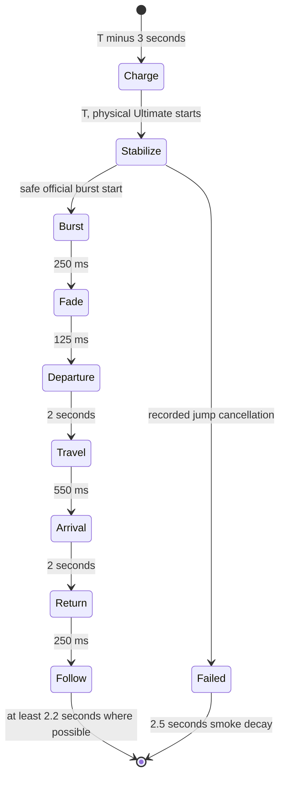

# Galactic Racing v0.13 — Final Lap / Cinematic boundary

Isolated implementation. Production, main, D1, migrations, Credit, AI and Phase3 operational code are outside scope. Parent: `ec27555df7e1d9b37f815a98632846bbabec08e6`; parent runtime `0f8802e2c994e0c445d8a7021f75cefba7af13b2`. Fresh main was `93646c066aaf8a33f1a7c062f8404dd7cd7b211e`. New branch `feature/galactic-racing-v013-final-lap-cinematic`.

## Engine contract

`v13/simulator.ts` reuses the accepted v12 motion policy and v10 assembly; only the version/RNG namespace and launch rule differ. Own official progress, not leader lap, is eligible in `[.88,.96)`. Weights `.35 / 1.6 / .65` apply to `[.88,.90) / [.90,.94) / [.94,.96)`. Eight equal racers, max one launch each, max two per race, 18s spacing, 10% Hyper type draw, and zero-activation races remain. Default is ten laps. No mandatory activation, winner selection or retrospective time editing.

Gold remains 2200–3200 permille, 6–11s, .75s ramp and existing incident resistance. Hyper retains 20–30% lap jump, 6000 permille one-tick visible burst, 2500–3000 afterburn for up to5s, 8s safe-entry timeout and .85-lap live-field governor. Actual boost can end early at terminal status/governor. Physical jump still occurs at phantomStart+3 ticks, afterburn at jump+1 tick. Display delay cannot write these timestamps or distances.

The shared incident boundary has one **opt-in** rule `protectActiveFromDsq`. During `tick < ultimateUntil`, an ordinary DSQ outcome returns false from the retirement callback and enters the existing finite major-incident penalty path. It consumes the existing penalty-duration RNG draw, with no reroll. DNF is unchanged. Pre-roll is not immunity. Outside that physical interval ordinary DSQ remains; podium special DSQ remains. Earlier versions do not opt in and retain their RNG paths/records. Incident-policy tests force active DSQ / outside DSQ / active DNF independently.

## Presentation state and precedence

`v13/presentation.ts` owns a WeakMap-cached plan derived from sealed official records. It does not mutate records. Renderer, HUD and minimap read the same pure time state. Ordinary playback remains in the historical adapter; no second RAF/director or physical accumulator is introduced.

Terminal finish/DNF/DSQ truncates any Hyper display state at the official terminal time. DNF routes to a 3.5s retirement shot. Ceremony always supersedes race cinematics. The actual official simulation, ranks, GAP and finish keep advancing while the body/billboard are invisible. Reappearance reads current official position; it cannot apply another jump. Target rank/GAP and minimap dot are masked with `WARP` while invisible, rather than showing invented values. Terminal status is never masked. Other racers keep their truthful official timing.

Cinematic camera placement: departure and arrival have fixed positions with panning aim. The intervening 550ms movement follows sampled road progress with a smoothstep envelope, not a chord through corners. Arrival camera pans toward the current hidden racer, then reveals the racer at that same current location. A bounded follow shot restores normal auto-angle coverage. `cinematic-effects.ts` owns a pooled ring, twelve sparks and eight smoke meshes; no lights/postprocess/randomness/resource growth. Reduced motion lowers effect intensity and spark count.

Precedence: viewer manual selection > preceding-frame P1 DNF emergency > current Hyper presentation / current Ultimate > normal competition director. P1 DNF bypasses minimum hold for3.5s. Other Ultimate-user DNF keeps a3.5s terminal shot. A later physical Ultimate can supersede an earlier, already physically ended presentation tail. Auto return derives the appropriate current lock from time. A manual angle never changes the official plan.

Failure uses only recorded cancellation. A cancelled entry stays visible while stabilizing; failure sparks/smoke decay in2.5s, with no new failure draw or extra penalty. DNF uses a mechanical failure/spark/smoke depiction at the actual track position, without fabricating an off-screen wall collision or moving the retired car to a shoulder.

## Test and release boundaries

- Pilot namespace `13pilot-`, first1000 full records. Freeze the launch/motion policy before independent `13holdout-0..39999`.
- Additional lap comparison `13lap{laps}-0..999`, each of1/3/5/10/15/30. This is exploratory frequency/length comparison, not a substitute for40k default-lap acceptance.
- Conditional KPI: prelaunch P5–P8, own progress `[.88,.96)`, RACING at launch; official final classification includes specialDSQ. v12's80.12% uses a different progress denominator and is a historical reference, not a like-for-like estimate.
- `test-racing-v13.mjs`: prior full hashes, immutable presentation, policy/forced incident tests, precise time boundaries, manual override, emergency cuts, Seek, GAP, six lap settings.
- `qa-cinematic.mjs`: real canvas alpha/body/billboard, fixed2s shots, dynamic 0.5/1/2x, full-screen, reduced motion, cancellation/DNF. A missed dynamic phase is PARTIAL at that rate, never silently PASS.
- `.github/workflows/racing-v013-cinematic.yml`: isolated Linux Chromium and Windows Chrome, delivered artifact reused on Windows, alternate port43875 and occupied-port failure. Software SwiftShader and actual user hardware performance are separate claims.

See `9R_V013_MEASURED_QA.md` for final measurements and remaining limitations. Phase3 remains documentation-only; fixed20:00/20:55/21:00KST contracts are unchanged.
